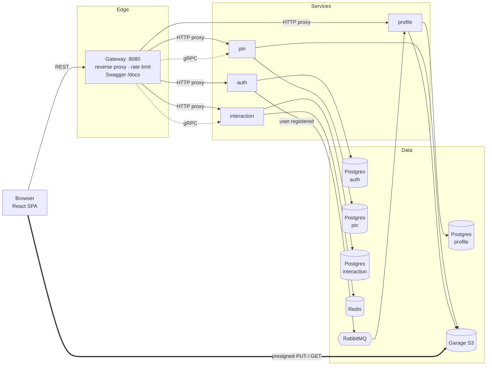
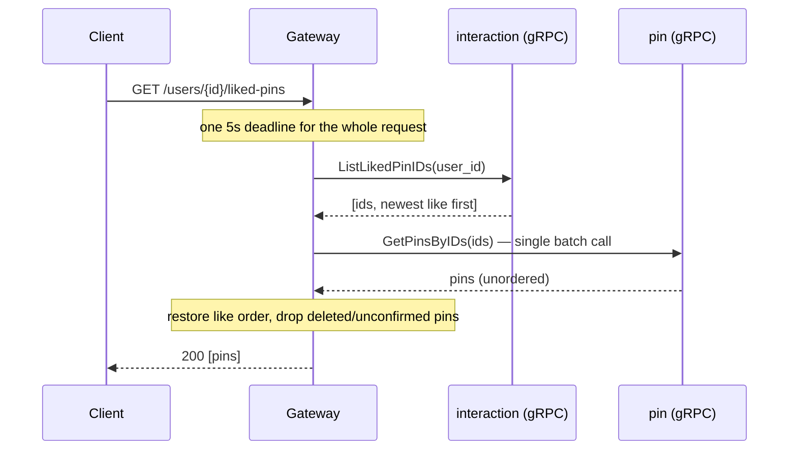

# Overview

This document explains how the project is structured and goes deeper into a few design decisions.

## Architecture



| Service         | Responsibility                                                                   | Notable tech                                                 |
| --------------- | -------------------------------------------------------------------------------- | ------------------------------------------------------------ |
| **gateway**     | Single entry point; proxies to the services and composes cross-service endpoints | chi, `httputil.ReverseProxy`, gRPC clients, embedded OpenAPI |
| **auth**        | Signup, login, JWT access tokens, rotating refresh tokens                        | bcrypt, HttpOnly cookies, RabbitMQ publisher                 |
| **pin**         | Pin CRUD, presigned uploads, cleanup of abandoned uploads                        | minio-go on Garage S3, gRPC server                           |
| **interaction** | Likes and like counts                                                            | Redis write-behind buffer, gRPC server                       |
| **profile**     | User profiles and avatars                                                        | RabbitMQ consumer, presigned uploads                         |

Each service owns its own Postgres database. Cross-service references are plain IDs with no foreign keys.

## Deep dive: service composition and events

### Composing over gRPC: `GET /users/{id}/liked-pins`

Liked pins live in two services: interaction knows _which_ pins a user liked, and pin knows _what_ they are. The gateway composes them over gRPC ([`backend/handlers/users/liked_pins.go`](backend/handlers/users/liked_pins.go)):



- **No N+1.** All the pins come back from one batched `GetPinsByIDs` call, not one call per ID.
- **Order is restored in the gateway.** It re-sorts the batch result by like order using a map, and skips pins that were deleted or never confirmed.
- **Errors map to HTTP.** gRPC status codes become HTTP statuses: `InvalidArgument` → 400, `Unavailable` → 503, `DeadlineExceeded` → 504.

### Event-driven profile creation

Signup never calls the profile service directly. Instead:

1. **auth** publishes a `UserRegisteredEvent` to the `userCreated` **quorum queue** over AMQP 1.0.
2. **profile** consumes it and creates the profile:
   - A malformed message is **discarded**, so a bad payload can't block the queue.
   - A transient failure is **requeued**.
   - On shutdown the consumer stops gracefully and finishes the message it is working on.

This keeps auth available even when profile is down. The profile gets created once profile comes back and works through the queue.

## Deep dive: auth and refresh-token rotation

**Access tokens.** Every service validates tokens with a shared `jwt.Manager` ([`backend/pkg/jwt/jwt.go`](backend/pkg/jwt/jwt.go)):

- Tokens are HS256 with a 1h TTL, a `jti` and an issuer.
- The manager rejects secrets shorter than 32 bytes and accepts only HMAC-signed tokens, which blocks `alg` confusion attacks.

**Refresh tokens:**

- Each one is 32 random bytes. Only its **SHA-256 hash** is stored, so a database leak exposes no usable tokens.
- It lives in an `HttpOnly; Secure; SameSite=Strict` cookie scoped to `Path=/auth`, so page JavaScript can't read it and the browser only sends it to the auth endpoints.
- It is **rotated on every refresh** and revoked on logout.

Passwords are hashed with bcrypt (cost 14).

**On the frontend** ([`frontend/src/context/authContext.jsx`](frontend/src/context/authContext.jsx)), the access token is kept **only in memory**, never in `localStorage`. Rotation creates a race: two requests that get a 401 at the same moment would each try to refresh, and the second would present a refresh token that was just revoked. React StrictMode's double-invoked effects trigger the same race. Refreshes therefore go through a single-flight promise:

```js
let refreshPromise = null
function refreshOnce() {
  if (!refreshPromise) {
    refreshPromise = refresh().finally(() => {
      refreshPromise = null
    })
  }
  return refreshPromise
}
```

All concurrent callers wait on the same refresh, and only one rotation happens.

`SameSite=Strict` needs the app and the API on the same origin. In development the Vite dev server proxies the API routes, which avoids CORS altogether.
