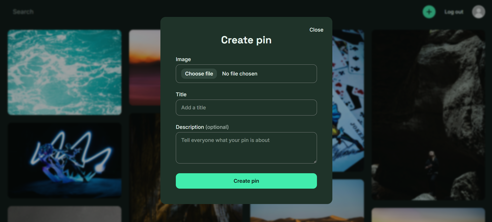
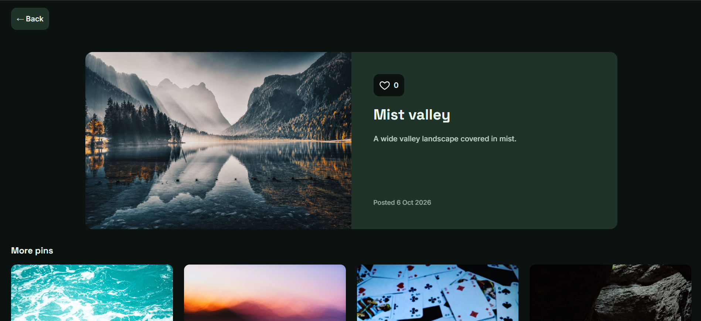

# Pinterest Clone

A Pinterest-style image-sharing app built on **Go microservices**, with a React frontend to show the image pipeline end to end.


> 🚧 Work in progress: this is a learning and portfolio project, and some rough edges remain.

## Screenshots

| Feed and search               | Upload                              |
| ----------------------------- | ----------------------------------- |
|  |    |
| **Pin detail**                | **Profile**                         |
|    |  |

## Architecture and Deep dive

See [Architecture](ARCHITECTURE.md) for a deep dive into how it works.

## Highlights

- **Direct-to-S3 uploads.** The browser `PUT`s the image straight to object storage with a presigned URL, so the API never streams file bytes. A confirm step validates the stored object with `StatObject` (content type and size). Pins stay `pending` until confirmed, and a background worker removes abandoned uploads, using a partial index on `image_status = 'pending'` to find them.
- **Two S3 clients.** The pin service talks to Garage over the internal Docker network but signs URLs with a public-endpoint client, so the presigned links resolve from the browser.
- **Write-behind like counter.** Likes increment a Redis delta and mark the pin dirty in one `MULTI`. Every 30s a worker drains deltas with `GETDEL` and upserts them into Postgres, putting a delta back if the write fails. Reads combine the DB and Redis values in parallel with `errgroup`.
- **Idempotent likes.** A repeated like or unlike is a no-op, and only real state changes touch the counter.
- **Token-bucket rate limiter.** Per-IP buckets with fractional refill and standard `RateLimit-*` / `Retry-After` headers.
- **Self-contained stack.** Every dependency has a healthcheck. Migrations and the seeder run as one-shot compose jobs, and services start only after them (`service_completed_successfully`). Services shut down gracefully on SIGINT/SIGTERM.
- **Frontend details:**
  - A CSS-column masonry grid.
  - Debounced search; stale requests are cancelled with `AbortController`.
  - An upload modal with a progress bar that deletes its pending pin if the upload fails.
  - A Vite proxy that keeps the app and the API on one origin.

## Getting started

You need Docker and Node.js.

```bash
git clone https://github.com/ArtemYarin/Pinterest-Clone-API
cd Pinterest-Clone-API

cp .env.example .env
docker compose up -d --build         # Backend, databases, Redis, RabbitMQ, Garage, seed data

cd frontend
cp .env.local.example .env.local
npm install && npm run dev           # Frontend
```

| What                  | Where                      |
| --------------------- | -------------------------- |
| App (Vite dev server) | http://localhost:5173      |
| API gateway           | http://localhost:8080      |
| Swagger UI            | http://localhost:8080/docs |
| RabbitMQ management   | http://localhost:15672     |

Seeded account: `seed@example.com` / `SeedPassword123!`

To regenerate the gRPC code, run `sh backend/proto/gen.sh`.

## Testing

Run from a service directory, e.g. `backend/services/pin`:

| Command                                            | Runs                                                                           |
| -------------------------------------------------- | ------------------------------------------------------------------------------ |
| `go test ./...`                                    | Unit tests: service logic with testify mocks, HTTP handlers via `httptest`     |
| `go test -tags integration ./...`                  | Plus integration tests against real Postgres 18 (testcontainers, needs Docker) |
| `go test ./internal/ -bench . -benchmem -run '^$'` | Benchmarks                                                                     |

- **Unit tests** are table-driven. Each case registers only the mock calls it expects, and an unexpected call fails the test.
- **Integration tests** start one Postgres container per run and apply the real migrations, so the schema, constraints and defaults are the production ones.
- **Benchmarks** measure the feed hot path (signing a presigned download URL per pin) with a real offline-signing S3 client, plus filter parsing and JSON encoding.

## Repository layout

```
.
├── compose.yaml            # full backend stack
├── backend/                # Go workspace
│   ├── cmd/                # gateway and seeder entry points
│   ├── router/ handlers/   # gateway routing, composed endpoints, OpenAPI
│   ├── pkg/                # shared: jwt, middleware, postgres, rabbitmq
│   ├── proto/ gen/         # gRPC contracts and generated code
│   └── services/           # auth, pin, interaction, profile
└── frontend/               # React 19 + Vite + Tailwind
```
